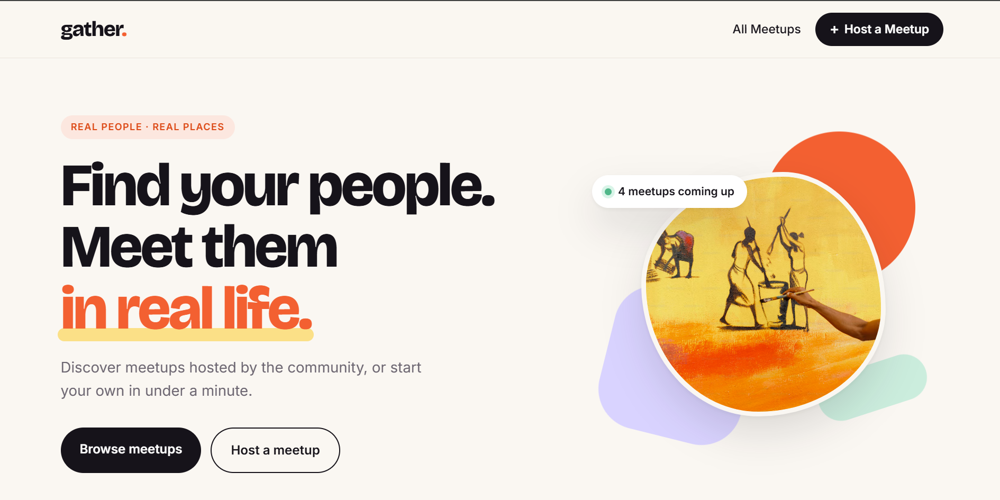

# gather.

A small meetup app built with Next.js and MongoDB. You can browse upcoming meetups, filter them by category, open one to see the details and add it to your calendar, or host your own.

**Live:** https://gather-omega-fawn.vercel.app/



## Background

This started as the "React Meetups" project from a Next.js course I took while learning the framework. The course version had a list page, a details page and a form, and the pages loaded their data by calling the app's own API at `http://localhost:3000`.

When I finished the course I kept going with it. Partly because I wanted something I could actually deploy (the localhost calls meant it only ever worked on my machine), and partly to practice the things the course skipped. The main changes:

- Redesigned the UI from scratch. Plain CSS Modules, no component library.
- Pages now query MongoDB directly inside `getServerSideProps` / `getStaticProps` instead of fetching their own API route.
- One shared MongoDB connection in `lib/mongodb.js` instead of opening a new client on every request.
- Details pages use ISR with `fallback: 'blocking'`. Before, any meetup created after the build went to a 404.
- The API validates input on the server and returns proper status codes (422 / 500 / 405). Previously a failed insert just left the request hanging with no response.
- Added dates, categories and capacity, a category filter that lives in the URL (`/?category=tech`), hiding past meetups, and an "Add to Google Calendar" button.

## Stack

- Next.js 12 (pages router) and React 18
- MongoDB Atlas with the official Node driver
- CSS Modules
- Hosted on Vercel

## How it's put together

| Route | What it does |
| --- | --- |
| `/` | Server-rendered on every request so new meetups show up straight away. Reads `?category=` for filtering. |
| `/[meetupId]` | Statically generated, revalidated every 60 seconds. Unknown ids return a real 404. |
| `/new-meetup` | The form. Posts to the API and shows the error message if validation fails. |
| `/api/new-meetup` | `GET` lists meetups, `POST` validates and creates one. |

Database code lives in `lib/meetups.js`, so both the pages and the API route use the same functions.

### Dates

Meetup times are stored as the local time at the venue, e.g. `2026-11-14T18:30`, which is also exactly what a `datetime-local` input gives you. I format them by hand in `lib/dates.js` rather than with `toLocaleString`. The server runs in UTC and the visitor's browser usually doesn't, so `toLocaleString` can give two different results for the same meetup, and React flags that as a hydration mismatch. Formatting the string myself makes the output identical on both sides.

## Running it locally

You'll need Node 22 and a MongoDB Atlas cluster. Next 12 doesn't build on Node 24+ (it bundles a library that uses `SlowBuffer`, which newer Node removed), so the version is pinned in `package.json`.

```bash
git clone https://github.com/FareenaAkram/gather.git
cd gather
npm install
cp .env.example .env.local   # then put your password in it
npm run dev
```

The connection string's username and cluster host are set in `lib/mongodb.js`. Only the password comes from the environment, so if you're using your own cluster, change those two there as well.

## Things I'd like to add

- Sign in with NextAuth so hosts can edit and delete their own meetups
- RSVPs with a "spots left" count, using the capacity field
- Image upload instead of pasting a URL
- A map on the details page
